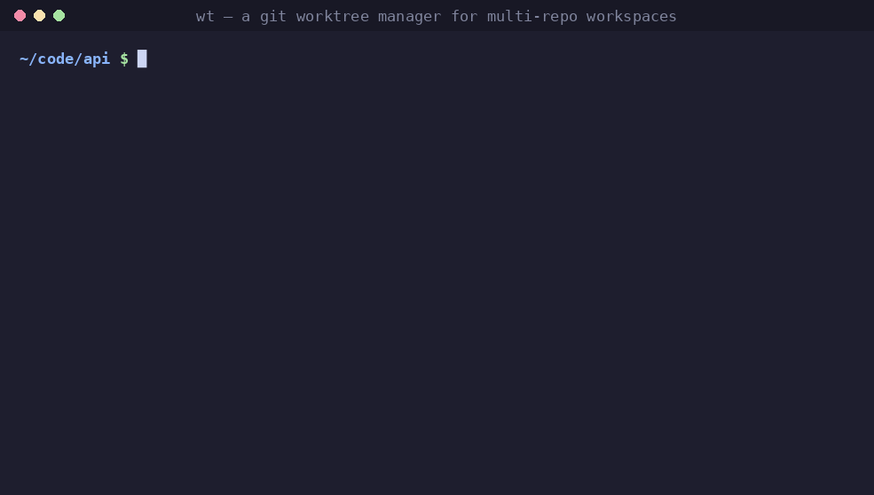

<div align="center">

# wt

**Git worktrees across every repository you work on, from one terminal.**

Jump to any worktree by name, see all of them in one table, run a command in
every one, and clean up when you are done. Built for running several AI agents
in parallel without losing track of where each one lives.

[](https://github.com/jMautone/worktree-manager/actions/workflows/ci.yml)
[](https://github.com/jMautone/worktree-manager/releases)
[](LICENSE)




</div>

---

## Why wt

Most worktree tools assume you are already inside the right repository. `wt`
doesn't. It finds your repositories under the folders you point it at,
resolves a name across all of them, and tells you when a name is ambiguous
instead of guessing.

> You have 10 repositories and 3 AI agents working in parallel, in different
> worktrees spread across them. You want to jump to any of them by name, see
> the state of all of them in one table, run a command across them, and close
> a worktree with a single command.

That is the workflow `wt` is built for.

## Features

- 🌳 **One command per step of a worktree's life.** `wt create` makes the
  worktree on a new branch and leaves you standing in it. `wt remove` deletes
  it, and its branch only when it is merged.
- 🧭 **Jump anywhere by name.** `wt cd auth-fix` finds the worktree in the
  current repository, a repository under your roots, or a worktree of
  another repository. `wt cd trend` reaches `TrendFisher` by unique prefix.
  `wt cd -` goes back, `wt cd ^` goes to the main worktree.
- 🗂️ **Multi-repo by design.** `wt list --all-repos` shows every worktree of
  every repository in one table. `api:feat` names a worktree of another
  repository from anywhere, in every command.
- 🔁 **Batch execution.** `wt each --all-repos npm test` runs a command in
  every worktree, one after the other, and sums up what failed.
- 🤖 **Agents run in the foreground.** `wt create fix-login -x claude` creates
  the worktree and starts the agent in it, in your terminal, with its exit
  code passed through.
- 🪝 **Hooks.** Copy `.env`, install dependencies or tear down a database
  around `create`, `cd` and `remove`. Slow cleanup runs in the background,
  with a log.
- 🛡️ **Safe by default.** Nothing with uncommitted changes is removed without
  `-f`, unmerged branches survive without `-D`, and `--dry-run` shows what
  would happen without touching anything.
- 🧩 **Scriptable.** Versioned `--json` output, documented exit codes
  (`4` means "that name is ambiguous") and `wt path` for scripts.
- 💻 **Every shell, every OS.** zsh, bash, fish and PowerShell 7 on macOS,
  Windows and Linux, with completions that know your worktrees and
  repositories.

## Quick start

```sh
# 1. Install the binary (see Installing below), then hook it into your shell:
echo 'eval "$(git-wt shell init zsh)"' >> ~/.zshrc && exec zsh

# 2. Tell wt where your repositories live:
export WT_REPOS_ROOT=~/code

# 3. Go.
wt create auth-fix            # new worktree + branch, and you are in it
wt create rate-limit -x claude # same, and start an agent there
wt cd web                     # jump to another repository
wt list --all-repos           # every worktree, every repository
wt remove api:auth-fix        # done: worktree gone, merged branch deleted
```

## Usage

### See everything at once

```console
$ wt list --all-repos
   REPO  NAME        BRANCH      HEAD     STATE  PATH
^  api   api         main        bdf20cc         ~/code/api
   api   auth-fix    auth-fix    bdf20cc         ~/code/api.worktrees/auth-fix
   api   rate-limit  rate-limit  bdf20cc         ~/code/api.worktrees/rate-limit
^  web   web         main        bdf20cc         ~/code/web
   web   dark-mode   dark-mode   bdf20cc         ~/code/web.worktrees/dark-mode
```

`^` marks the main worktree and `@` the one you are in.

### Run something everywhere

```console
$ wt each --all-repos git branch --show-current
==> api:^  ~/code/api
main
==> api:auth-fix  ~/code/api.worktrees/auth-fix
auth-fix
==> web:dark-mode  ~/code/web.worktrees/dark-mode
dark-mode
```

A single quoted word runs as a shell line (`wt each 'npm ci && npm test'`);
several words reach the program as you typed them.

### Commands

| Command | What it does |
|---|---|
| `wt create <name> [-b <branch>] [--base <ref>] [-x <cmd>]` | Create a worktree on a new branch and move into it |
| `wt cd [<name>\|<repo>\|<repo>:<name>\|-\|^\|@]` | Move the shell to a worktree or a repository |
| `wt list [--all-repos]` | List worktrees, of this repository or of all of them |
| `wt repos` | List the repositories under your roots |
| `wt each [--all-repos] <cmd>...` | Run a command in every worktree |
| `wt sync [<name>...] [--all] [--base <ref>] [--no-fetch]` | Rebase worktrees onto their base, skipping dirty ones |
| `wt remove <target> [-f] [-D] [--keep-branch]` | Remove a worktree, and its branch when merged |
| `wt path <target>` | Print a worktree's path, for scripts |
| `wt lock <target> [<reason>]` / `wt unlock <target>` | Protect a worktree from removal |
| `wt prune` | Forget worktrees whose directory is gone |
| `wt config list\|get\|path` | Inspect the configuration and where each value comes from |

Every command takes `--json`, `--dry-run`, `--no-color` and `-C <dir>`.
`wt <command> --help` explains each one in detail.

## Installing

Download the archive for your platform from
[Releases](https://github.com/jMautone/worktree-manager/releases) and put
`git-wt` on your `PATH`. Builds are published for macOS (arm64, amd64),
Windows (amd64) and Linux (amd64, arm64).

With Go installed, name the version explicitly:

```sh
go install github.com/jMautone/worktree-manager/cmd/git-wt@v0.3.0-alpha.1
```

`@latest` does not work until `1.0.0`: the Go module proxy still serves an old
`v0.9.0` that has no Go code.

### Shell integration

The `wt` you type is a shell function that runs `git-wt`: a binary cannot
change the directory of the shell that started it, so `wt cd` needs the
function. Add the line for your shell to its startup file:

| Shell | File | Line |
|---|---|---|
| zsh | `~/.zshrc` | `eval "$(git-wt shell init zsh)"` |
| bash | `~/.bashrc` | `eval "$(git-wt shell init bash)"` |
| fish | `~/.config/fish/config.fish` | `git-wt shell init fish \| source` |
| PowerShell 7 | `$PROFILE` | `Invoke-Expression (& git-wt shell init pwsh \| Out-String)` |

The line also registers completions: in zsh, `compinit` must run before it;
in bash, the `bash-completion` package must be loaded before it.

Supported: zsh 5.8, bash 3.2, fish 3.3 and PowerShell 7.4, or later. On
Windows, the function hides `wt.exe` (Windows Terminal): type `wt.exe` to open
it. Because the binary is named `git-wt`, git also runs it as `git wt <cmd>`.

## Configuration

`wt` works with no configuration. Values come from, lowest to highest
precedence: defaults, your user file, the repository's `.wt.toml` (allowlisted
keys only) and `WT_<KEY>` environment variables. `wt config path` shows where
the files are, and `wt config list` shows every value and its source.

```toml
repos_root    = ["~/code", "~/work"]   # where your repositories live
repos_depth   = 1                      # how deep to look under each root (1-3)
worktree_path = "{repo_parent}/{repo}.worktrees/{name|sanitize}"
branch_prefix = ""                     # e.g. "me/"
default_base  = ""                     # defaults to the repository's default branch

[hooks]
post-create = ['cp "{repo_path}/.env" .env', "npm ci"]
post-remove = ["docker rm -f {repo}-{name|sanitize}-db"]
```

Hooks run with `sh -c` on macOS and Linux and `cmd.exe` on Windows. `pre-*`
and `post-create` block; `post-cd` and `post-remove` run in the background and
write a log. `--no-hooks` skips them for one run.

A repository can share its hooks in a `[hooks]` table of its `.wt.toml`. They
run after yours, and only once you approve them: `wt hook list` shows what
would run, and `wt hook approve` approves each command for that repository and
event. If a command changes, it needs approving again.

## Principles

- **Terminal-first.** A command leaves you standing in the worktree, in the
  same terminal. Nothing opens an external application by default.
- **Agents run in the foreground.** `-x <cmd>` runs inside the worktree, in
  your terminal, and passes its exit code through.
- **Nothing is hardcoded to one tool.** Editor, terminal and agent are yours
  to choose.
- **A repository does not run code without permission.** A repository's
  `.wt.toml` only sets allowlisted keys, and its hooks run only once you
  approve each command.
- **The contract is public.** Exit codes, versioned `--json` and `--dry-run`
  are part of the API.

## Roadmap

`wt` ships one milestone per minor version. Pre-releases of the open
milestone are on [Releases](https://github.com/jMautone/worktree-manager/releases).

| | Milestone | Version | |
|---|---|---|---|
| ✅ | **Usable skeleton**: list, cd, create, remove, shell integration | `0.1.0` | released |
| ✅ | **The differentiator**: multi-repo workspace, cross-repo names, batch | `0.2.0` | released |
| 🚧 | **Closing the loop**: hooks, project hooks, sync, merge | `0.3.0` | in progress |
| ⏳ | **Richness**: one rich list view, branch state, picker, statusline | `0.4.0` | |
| ⏳ | **Extension**: launchers, aliases, doctor | `1.0.0` | |
| ⏳ | **Product**: dashboard, agent integrations, distribution | `1.1.0` | |

The full design is in [docs/design/product.md](docs/design/product.md)
(Spanish).

## Contributing

Every change to what `wt` does goes through [OpenSpec](https://openspec.dev):
durable capabilities live in `openspec/specs/`, work in flight in
`openspec/changes/`. Branches, pull request titles, versions and the
step-by-step workflow are in [CONTRIBUTING.md](CONTRIBUTING.md).

```sh
go build ./cmd/git-wt
go test -race ./...
```

## License

[MIT](LICENSE)
